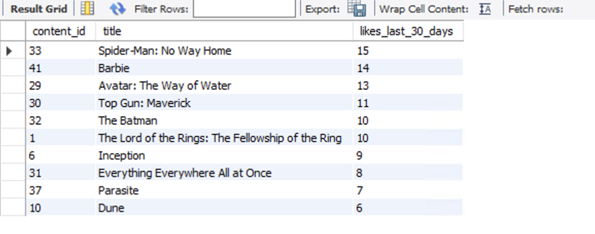

# Streaming Platform SQL Analytics

A relational database project by **Isha Shah**, exploring how a streaming service can connect subscribers, subscriptions, payments, content, and viewing activity to answer business questions with SQL.

The project includes a MySQL Workbench model, a written report, sample data, and five analytical queries. It demonstrates relational modeling, primary and foreign keys, many-to-many bridge tables, joins, aggregations, and date-based analysis.

**[Read the project report (PDF)](reports/streaming-platform-report.pdf)** · **[Open the Workbench model](model/streaming-platform.mwb)** · **[Explore the SQL](sql/03_analysis.sql)**

## My contribution

I completed the entire project: translating the business questions into a database design, building the ERD, writing the schema and data inserts, developing the five analyses, and presenting the results in the report, including an Excel chart.

## Business questions

1. Which movies received the most likes in the recent viewing period?
2. What proportion of viewing events used the subscriber's preferred language?
3. Which countries have the most active subscriptions?
4. How can monthly subscription payments be explored alongside content genres?
5. Which actors' content accumulated the most watch time?

The second question is phrased here to reflect what the SQL actually measures. The original revenue-by-genre analysis has an aggregation limitation described below.

## Results from the sample data

The synthetic dataset contains **17 tables and 831 rows**, including 30 subscribers, 41 content titles, 77 payments, and 220 viewing events.

| Analysis | Result |
| --- | --- |
| Trending movies | *Spider-Man: No Way Home* leads with 15 liked viewing events, followed by *Barbie* with 14 and *Avatar: The Way of Water* with 13. |
| Preferred language | 194 of 220 eligible viewing events used the subscriber's preferred language: **88.18%**. |
| Active subscriptions | United States: 5; France: 3; Germany: 3; Brazil: 2; Japan: 2. |
| Actor watch time | Elijah Wood, Ian McKellen, and Cate Blanchett each have 2,830 attributed minutes, or **47.17 hours**, for the content linked to them. |



*Original result image extracted from report page 23. These are sample-data results, not measurements from a live streaming service. The recent viewing period is anchored to the latest date in the dataset, 2024-12-04.*

The report also contains a monthly genre chart. Its query joins payments to all of a subscriber's viewings and then to each content genre, so the same payment can contribute repeatedly. **That chart should not be interpreted as actual revenue allocated by genre.** The original query is retained and annotated in the SQL files for transparency.

## Tools and design

- **MySQL / SQL:** table definitions, sample inserts, relational constraints, and analytical queries.
- **MySQL Workbench:** editable physical ERD covering 17 tables and 18 foreign-key relationships. The model records a MySQL 8.0.33 target.
- **Microsoft Excel:** the report describes exporting and pivoting the genre-query output to create its chart. The workbook is not included.

The design separates subscriber activity from subscription billing. Lookup tables represent languages, countries, genres, and statuses; `content_actor`, `content_genre`, and `content_language` resolve many-to-many relationships. The report describes the schema as normalized to third normal form.

## Repository contents

```text
.
├── README.md
├── assets/
│   └── trending-movies.png
├── docs/
│   └── project-notes.md
├── model/
│   └── streaming-platform.mwb
├── reports/
│   └── streaming-platform-report.pdf
└── sql/
    ├── 01_schema.sql
    ├── 02_seed.sql
    └── 03_analysis.sql
```

The PDF is the portfolio edition of the report; the `.mwb` file is the retained editable model. The SQL files were transcribed from the report to make the work easier to inspect and run. [Project notes](docs/project-notes.md) describe the deliverables, transcription changes, and validation details.

## Run the SQL

Use a running **MySQL 8.x** server and the `mysql` command-line client. Your account needs permission to create a database and tables and insert/query data. Run these commands from the repository root, replacing `YOUR_MYSQL_USER` with your local database username. Each `-p` prompts for the password.

Create a new, empty database:

```sh
mysql --default-character-set=utf8mb4 -u YOUR_MYSQL_USER -p \
  -e "CREATE DATABASE streaming_portfolio CHARACTER SET utf8mb4;"
```

Load the schema, sample data, and analyses in order:

```sh
mysql --default-character-set=utf8mb4 -u YOUR_MYSQL_USER -p streaming_portfolio < sql/01_schema.sql
mysql --default-character-set=utf8mb4 -u YOUR_MYSQL_USER -p streaming_portfolio < sql/02_seed.sql
mysql --default-character-set=utf8mb4 -u YOUR_MYSQL_USER -p streaming_portfolio < sql/03_analysis.sql
```

Run the schema and seed once per empty database; they do not drop or overwrite existing tables. The sample name `O'Connor` uses standard SQL quote escaping. No password or server connection is stored in these files.

Alternatively, open the `.mwb` file in MySQL Workbench to inspect the ERD. To execute the SQL in Workbench, select your new database and run the three SQL files in numerical order. The SQL files have no file-path dependencies; moving the self-contained report and model did not require code-path changes.

**Execution evidence:** I ran the project during its original development; the report includes query-output screenshots and the Excel chart. The commands above let visitors reproduce the work. During portfolio preparation, an additional SQLite compatibility check passed after adapting MySQL's auto-increment and date syntax. Foreign-key and integrity checks passed; table/column names and foreign-key relationships match the model, and Q1, Q2, Q3, and Q5 reproduce the saved result values. This additional check was not a fresh MySQL execution.

## Limitations and next steps

- The original Q4 join repeats payment amounts. A future revision needs an explicit revenue-allocation rule and a defined relationship between payment month and viewing period.
- Q2 measures viewing events, not distinct subscribers. Q5 attributes a content item's full viewing time to each linked actor, so actor totals overlap.
- Shows are modeled as single content records, without seasons or episodes. Device entities, device-limit enforcement, authentication, household profiles, and plan-price history are outside the implemented schema.
- Some content-to-actor links use stand-ins, as noted in the sample inserts. The data is an illustrative fixture rather than an authoritative entertainment catalog.
- Payment data covers January-November 2024; Q4 filters calendar year 2024. Q1 and Q5 use the latest viewing date in the sample, rather than today's date.
- The editable Excel workbook and original standalone SQL source files were not present. The SQL here is the documented transcription of the report.
